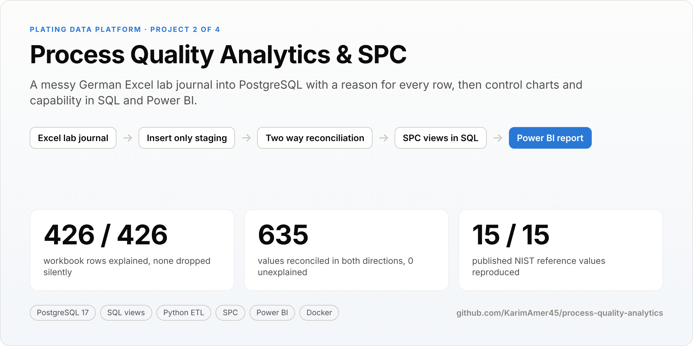
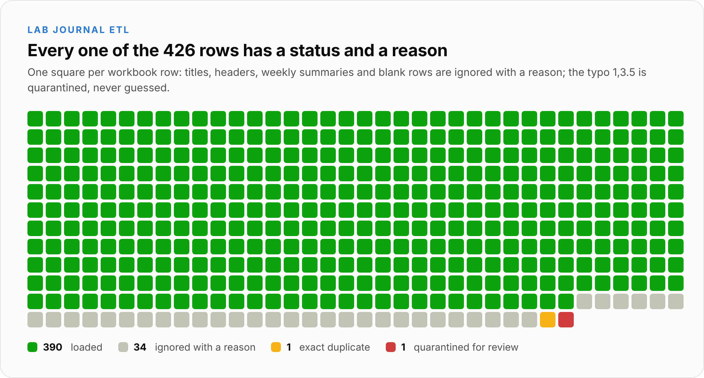
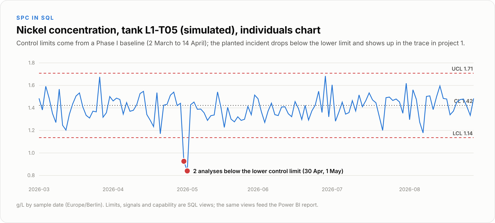
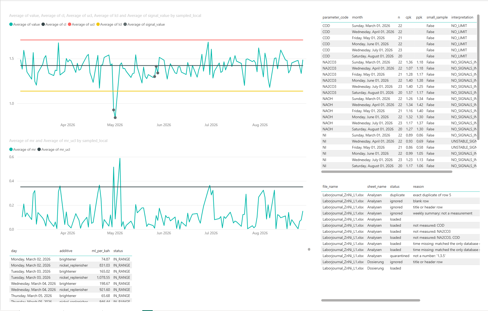

<p align="center"></p>

<p align="center"><a href="https://github.com/KarimAmer45/process-quality-analytics/actions/workflows/verify.yml"></a>    </p>
<p align="center">Plating Data Platform: <a href="https://github.com/KarimAmer45/manufacturing-traceability">Traceability</a> &middot; <b>Lab ETL & SPC</b> &middot; <a href="https://github.com/KarimAmer45/industrial-iot-historian">IoT historian</a> &middot; <a href="https://github.com/KarimAmer45/coating-specification-engine">Specification & release</a></p>

Labs keep their bath analyses in Excel. This project moves a deliberately messy German lab journal into PostgreSQL without losing or guessing a single row, reconciles the result against the database in both directions, and then runs statistical process control on it, all as SQL views that also feed a Power BI report.

> **Kurzfassung:** Ein bewusst unordentliches Laborjournal aus Excel wird nach PostgreSQL übernommen, ohne dass eine Zeile verloren geht oder geraten wird, und in beide Richtungen mit der Datenbank abgeglichen. Darauf laufen I-MR-Regelkarten, Run-Regel und monatliche Cpk/Ppk-Werte als SQL-Sichten, die auch einen Power-BI-Bericht speisen. Bad- und Labordaten sind simuliert; NIST und UCI SECOM sind echte öffentliche Datensätze.

<p align="center"></p>

<p align="center"></p>

<table>
<tr>
<td width="50%"></td>
<td width="50%"></td>
</tr>
<tr><td align="center">Power BI, tank page (refreshed in Desktop)</td><td align="center">Power BI, NIST case study page</td></tr>
</table>

## Inside the database

- **Nothing dropped silently.** Raw rows go into an insert only staging ledger with the file hash; every row ends as loaded, ignored, duplicate or quarantined, each with a reason. Reimporting the same file changes nothing.
- **Reconciliation both ways.** Workbook to database and database to workbook: 635 values matched, 15 explicit "n.b." gaps, zero unexplained rows or conflicts.
- **SPC as SQL.** Individuals and moving range charts, run rule 4 (eight in a row) and monthly Cpk and Ppk with time-valid specification limits, all views.
- **Checked against published answers.** 15 NIST reference values reproduced; 590 real UCI SECOM sensors ranked in a materialized view against a chance reference.
- **BI on a read only login.** Power BI reads only seven database views, with no credentials in the project files; 57 tests on every push.

## Run it

```bash
cp .env.example .env    # set a local password
docker compose up -d db
docker compose run --rm demo
```

The demo downloads the NIST and UCI SECOM files, builds everything from an empty database and writes the evidence to `docs/results/`. Details are in the [report](REPORT.md).

## Data

The bath, schedule, workbook and doses are **simulated** from cited public sources; the NIST lithography data and UCI SECOM are **real** public datasets. This is a portfolio demonstration, not company production data or a dosing controller.

---

**Full technical report:** [REPORT.md](REPORT.md) has every result table, the evidence file behind each number, how each part is run and the known limitations.

Built by [Karim Amer](https://github.com/KarimAmer45), M.Sc. Mobile Robotics student at the University of Bonn.
