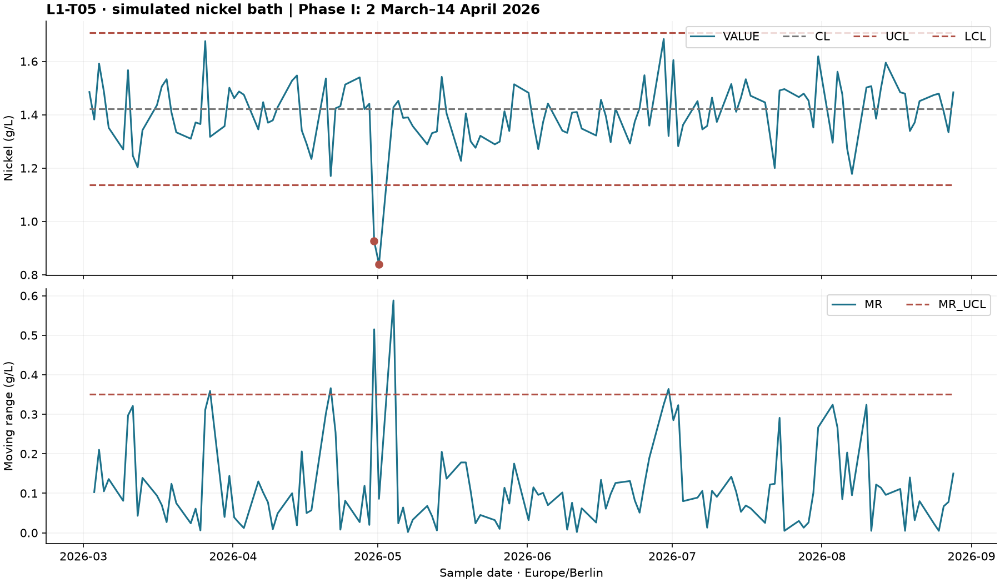
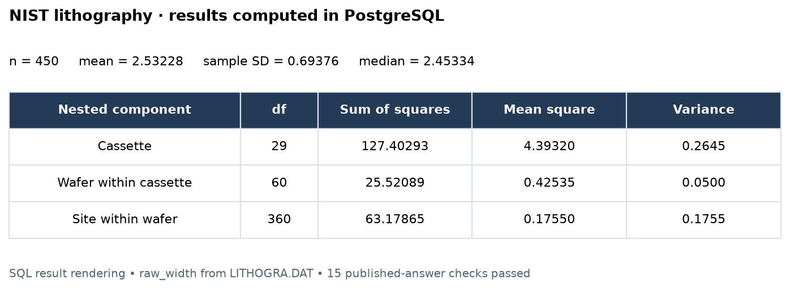
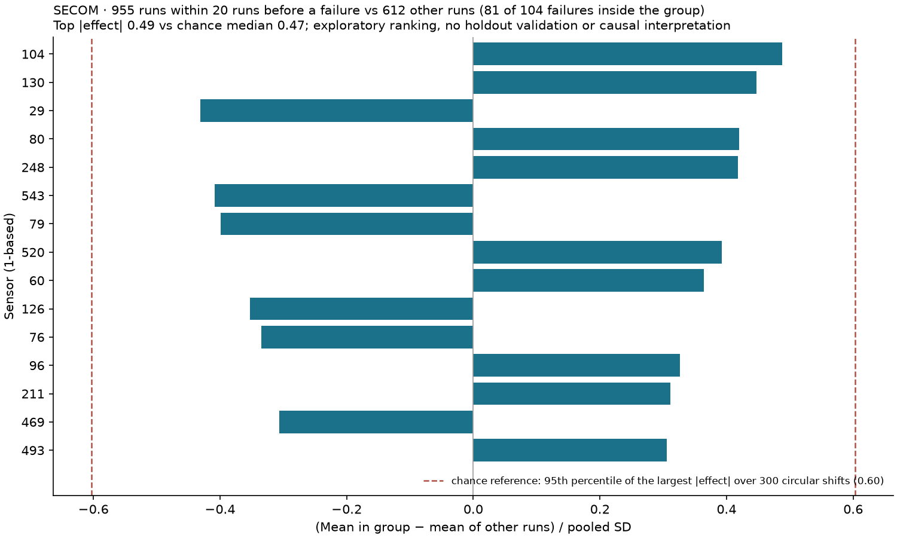

# Process Quality Analytics & Statistical Process Control

Project 2 moves a deliberately messy laboratory workbook into PostgreSQL with an explanation for every row, then calculates I-MR charts, run rules and monthly capability. It also reproduces published NIST statistics and explores the real UCI SECOM dataset.

This folder is self-contained. The plating bath, production schedule, workbook and doses are **simulated**; the NIST and SECOM files are **real public data**. This is a portfolio demonstration, not Partec production data or a dosing controller.

## What is implemented

| Requirement | Implementation and evidence |
| --- | --- |
| Explain every workbook row | `ingest/etl_lab_journal.py`; file hashes, raw row staging in an insert-only ledger, quarantine reasons, dry run, and reconciliation in both directions (workbook → database and database → workbook) |
| Rule 4 | `lab.v_run_rules` and `lab.v_rule4_runs`; eight consecutive points on one side, equality resets the run, first alarm at point eight |
| SPC baseline | Phase I comes from `config/sources.yaml`; a baseline with fewer than 20 points gives an explicit `NO_BASELINE` / `INSUFFICIENT_BASELINE` status ([spc_status.csv](docs/results/spc_status.csv)) |
| Cpk by parameter/month | `lab.v_monthly_capability`; time-valid specification limits, separate partitions when limits change, Ppk next to Cpk, n < 20 flag, label from the month's actual signals |
| Published NIST answers | 15 independent checks in [nist_validation.json](docs/results/nist_validation.json) |
| SECOM feature ranking | Materialized view, 590 sensors, preceding 20 runs in timestamp order, with group sizes and a circular-shift chance reference ([secom_null.json](docs/results/secom_null.json)) |
| Dose per kAh | 260 daily totals, normalized by simulated load area × current density × elapsed hours (a unit and round-trip check, see below) |
| Power BI | Three pages and eight visuals in [BathLab.pbip](powerbi/BathLab.pbip), sourced exclusively from seven database views |
| Reproducibility | Clean-database build and repeat checks in [clean_verification.json](docs/results/clean_verification.json); integration tests |

I ran the database workflow locally. The Power BI project is generated and its PBIP/PBIR files are checked against Microsoft's JSON schemas. On 2026-10-11 I opened it in Power BI Desktop, refreshed it against my local database with a `role_readonly` login and checked all three pages ([L1-T05](docs/results/powerbi_l1t05.png), [NIST](docs/results/powerbi_nist.png), [SECOM](docs/results/powerbi_secom.png)). The Docker path ran cleanly on 2026-10-12 (see below); the included GitHub Actions workflow is provided but I have not run it.

## Results

The example workbook has 426 rows across two sheets:

| Status | Analysen | Dosierung | Total |
| --- | ---: | ---: | ---: |
| Loaded/accepted | 130 | 260 | 390 |
| Ignored with reason | 30 | 4 | 34 |
| Exact duplicate | 1 | 0 | 1 |
| Quarantined typo | 1 | 0 | 1 |

Every number is explained. The 34 ignored rows are titles, headers, weekly summaries or blank rows. The duplicate is a repeated analysis; the quarantined value is deliberately malformed `1,3.5`. There are **635 matching measurements**, **15 database-only measurements explicitly marked `n.b.` in the workbook**, and **zero unexplained rows, source-only values or conflicting values**. In the other direction, the database holds **no analysis or dose** inside the workbook's tank and date range that the workbook lacks. Four rows have no time; each matches the only database sample of its date (06:00), so nothing is imputed. “Loaded” counts accepted source rows, including observations already present in the simulator's database; it does not mean 390 new inserts on every import. The workbook is generated from the same database, so these totals are a round-trip check of the parser and reconciliation, not an independent data source. See [ETL report](docs/results/etl_applied.json) and [row status breakdown](docs/results/etl_status.csv).

Reimporting the exact file hash returns the original report with `reused: true` and `inserted_this_run: 0`, without changing staging or business data. Because that stored report describes the database at the first import, the reuse also repeats the database → workbook comparison as a dry run and adds `review_required_now` and `database_only_rows_now`, so rows added or removed since then are visible. A new version with the same filename retains the previous version's rows. Dashboard ETL totals show only the latest applied version for each filename, with the file name in the Power BI table.

Corrections in a new workbook version are reported rather than applied:

| Change in the new version | What the import does |
| --- | --- |
| Value changed at an existing time | Row quarantined (`database conflict`), stored value kept |
| Time changed (06:00 → 06:30) on a day that already has a sample | Row quarantined as a possible re-keyed correction; nothing inserted |
| New time whose values equal another sample of the same tank and day (in the workbook or the database) | Row quarantined as a changed time or copied row |
| Date changed, values unchanged | Row quarantined (`changed date?`); nothing inserted |
| Analysis or dose row deleted or blanked | The database row is listed under `database_only_rows` and counted in `review_required` |
| Time missing | Matches the single database sample of that tank and date; otherwise quarantined (no assumed 06:00) |
| Date outside 2020-01-01 … import day (e.g. 2062), or a time later than now | Row quarantined; the date window is configurable in `config/sources.yaml` |
| Daily dose total: time changed or missing | Same event (tank, Berlin date, additive): a changed time is counted as `retimed_daily_totals`, a missing time is noted on the row; nothing inserted. A new daily total without time is quarantined |
| Two dose rows for one day and additive at different explicit times | Both rows quarantined (even with equal amounts); the stored total is reported as database-only. Rows count as one event only when the amounts agree and the times agree or one is missing |
| Daily dose total: amount changed | Row quarantined, stored amount kept |
| Summary label (`Mittelwert…`) on a row with time or tank, or a value in a column without header | Row quarantined |

I re-ran these cases against a freshly built database; the report flags each one and none inserts a row.



The Phase I interval is 2 March to 15 April 2026 (Berlin dates, upper endpoint excluded), read from `assumptions.spc_phase_one` in [config/sources.yaml](config/sources.yaml). The journal generator refuses to store a baseline with fewer than 20 values per parameter, and the chart views (and `lab.imr_chart` by default) only draw limits when the baseline has at least its minimum number of points (20; a test fixture may pass a lower minimum explicitly); otherwise every row carries `NO_BASELINE` or `INSUFFICIENT_BASELINE` instead of silently empty breach flags. Baseline edits are audited. Nickel CL = 1.422125 g/L, LCL ≈ 1.136218 and UCL ≈ 1.708032 from 32 baseline points. Only **30 April and 1 May** breach the individuals limits, matching the planted shortfall. Moving-range excursions are shown separately; an MR excursion need not imply an individuals-limit breach. Phase I itself contains one: on **27 March** the moving range (0.359 g/L) slightly exceeds its limit (0.351 g/L). The baseline includes that moving range, so the nickel limits are slightly wider than they would be without it.

Rule 4 finds two runs: nickel below CL for 10 observations on **15–28 May**, first signaling on **26 May**, and zinc above CL for eight observations on **6–17 August**, first signaling on **17 August**. These occur in generated random variation and are separate from the deliberately planted April/May incident. The data provides no evidence of another physical cause. See [all run boundaries](docs/results/rule4_runs.csv).

Cpk uses mean moving range / 1.128 for within-process sigma and the appropriate specification version; Ppk next to it uses the overall sample standard deviation. Missing limits, fewer than two observations or zero variation yield null capability. Available one-sided limits are supported. Month and limit boundaries never share a moving range. Months with fewer than 20 values are flagged (`small_sample`) but still reported. The label comes from the month's actual signals: `UNSTABLE_SIGNALS_IN_MONTH` when the month has an individuals-limit breach or a Rule 4 signal, otherwise `NO_SIGNALS_IN_MONTH` (moving-range excursions are counted in their own column). Signals are counted per calendar month, not per limit version: when limits change mid-month, both rows of that month carry the same counts and label. Nickel April (Cpk 0.93, Ppk 0.69) and May (Cpk 0.86, Ppk 0.58) are labelled unstable, so their Cpk is not a capability statement. Even in months without signals, nickel Cpk stays below 1 (March 0.89, June 0.99): the simulated bath is not shown to be capable. See [capability.csv](docs/results/capability.csv).



This image renders the actual SQL query output; it is not a SQL-client screenshot. All 15 checks reproduce the [NIST summary](https://www.itl.nist.gov/div898/handbook/pmc/section6/pmc612.htm) and [nested ANOVA](https://www.itl.nist.gov/div898/handbook/pmc/section6/pmc613.htm) to their published precision. The balanced 30 × 3 × 5 design uses the **raw width** column. Degrees of freedom, sums of squares and method-of-moments variance components are calculated in SQL, not copied from the published results.



The [UCI SECOM dataset](https://archive.ics.uci.edu/dataset/179/secom) has 1,567 runs, 104 failures and a downloaded matrix of 590 sensor columns. UCI's current metadata lists 591 features; the loader documents that discrepancy and validates the actual matrix. It stores 882,579 observed values and omits 41,951 missing values (4.5375%), without replacing missing values with zero. Timestamps carry no source timezone and are retained without inventing one. Sensor numbering here starts at **1**.

Each run belongs to the comparison group if a failed run occurs among its next 20 timestamp-ordered observations; original row ID resolves timestamp ties. A failure is excluded from its own preceding window, but can belong to a later failure's window. Overlapping windows count a run only once. Because failures are close together (median gap 7 runs), the group holds **955 of 1,567 runs** against **612 other runs**, and **81 of the 104 failures** sit inside it. The signed difference in means is divided by the pooled sample standard deviation and ranked by absolute effect size. Constant, all-missing and insufficient-data sensors retain explicit statuses.

The ranking does not beat chance. The top effect is 0.488 (sensor 104). Rotating the failure labels in time 300 times (fixed seed, spacing kept) and recomputing the whole ranking gives a largest effect with median 0.472 and 95th percentile 0.603; about 40% of the rotations reach 0.488 or more. The chart shows the 95th percentile as a dashed line ([secom_null.json](docs/results/secom_null.json)). This is retrospective exploration with overlapping windows and 590 uncorrected comparisons, not validated prediction or causal evidence.

Long format makes sensor-level grouping and joins to the failure-window membership table identical for every sensor. A single SQL aggregation replaces 590 separately written expressions and naturally excludes missing observations.

All 130 nickel-replenisher daily totals fall within the source TDS interval of **750–1100 mL/kAh**; brightener totals use **50–200 mL/kAh**. The doses were generated inside these ranges, so this is a unit and round-trip check of conversion, daily totals and charge normalization, not an independent validation of industrial consumption. Charge is split at Berlin midnight by `lab.berlin_day_slices`, which a test checks across both 2026 daylight-saving changes and in four session time zones. Sources and modeling assumptions are in [config/sources.yaml](config/sources.yaml).

## Run from a fresh checkout

Requirements: Python 3.11+ and PostgreSQL 17; alternatively Docker Compose. No Kaggle account is needed. The demo downloads the NIST file and UCI archive directly and writes a SHA-256 [provenance manifest](docs/results/download_manifest.json). Data, passwords and local runtimes are excluded from Git.

### Docker

```powershell
Copy-Item .env.example .env
# Edit .env and choose a password.
docker compose up -d db
docker compose run --rm demo
```

The new Docker database defaults to host port 55434. Its credentials and database are controlled by `POSTGRES_*`; the demo connects to the container by libpq variables. It uses the Python migration runner, not Flyway. Results, downloaded data and Power BI files are mounted back into this folder. Repeating the demo preserves seeded business data. `docker compose down` stops the services while retaining the database volume.

I ran these two commands on 2026-10-12 with Docker Desktop on Windows against a fresh PostgreSQL 17 container: all migrations applied, the ETL loaded 390 of 426 journal rows with 635 matched values and no unexplained rows, the 15 published NIST values were reproduced, the Power BI files were regenerated and all 56 tests in the suite at that time passed (the test for unreadable rows of a stored sample was added afterwards). The files committed in `docs/results/` come from my native run.

### Native Python / PostgreSQL

Create an empty `bath_lab_spc` database using a database owner able to create the `btree_gist` extension and the project's NOLOGIN group roles. In a virtual environment:

```powershell
python -m venv .venv
.\.venv\Scripts\python -m pip install -r requirements.txt
Copy-Item .env.example .env
# Edit DATABASE_URL to point to your PostgreSQL database.
.\scripts\project.ps1 demo -Python .\.venv\Scripts\python.exe
```

On macOS/Linux, export `DATABASE_URL` (or libpq `PGHOST`, `PGPORT`, `PGUSER`, `PGPASSWORD`, `PGDATABASE`) and run `python scripts/demo.py`. Native Python reads those environment variables; `project.ps1` additionally loads `.env`. Do not set an old `DATABASE_URL` alongside new libpq variables: the URL takes precedence.

The demo applies thirteen versioned migrations and the grant file, seeds the production foundation, downloads and loads reference data, generates the journal, performs dry-run and applied ETL, validates NIST, exports charts/results, generates the Power BI project and runs tests. The optional artifact-tool Node writer creates the locally delivered workbook and previews; installations without that engine use the portable openpyxl writer. Its byte hash can differ but parsed contents and expected statuses are the same.

Individual actions:

```powershell
.\scripts\project.ps1 migrate
.\scripts\project.ps1 load
.\scripts\project.ps1 validate
.\scripts\project.ps1 export
.\scripts\project.ps1 test
python ingest/etl_lab_journal.py                 # dry run, no DB writes
python ingest/etl_lab_journal.py --apply         # transactional import
python scripts/verify_clean.py                  # needs CREATEDB; isolated build twice
python scripts/fetch_powerbi_schemas.py
python scripts/validate_powerbi.py
```

For direct Python commands, first activate the virtual environment and export connection variables. `verify_clean.py` creates only its own randomly named `bath_verify_*` database, removes that database in `finally`, and preserves the working database. Exported evidence is overwritten by verification results. [SQL examples](sql/queries/p2_spc.sql) cover tasks A–E.

## Data contract and architecture

`Workbook → parser → raw row staging + file ledger → lab tables → SQL views → Power BI / static exports`.

Dates accept typed Excel dates and explicit text formats and must lie between 2020-01-01 and the import day. Decimal comma and decimal point are supported; formulas, malformed/negative/nonfinite values, unknown aliases and ambiguous/nonexistent Berlin times are rejected. A missing time is never filled in: the row may only confirm the single existing sample of that tank and Berlin date. Optional `n.b.` readings stay missing. Raw values are retained in JSON with date/time type tags; Excel formatting is not a measurement. Required sheets/headers fail the file before any write. Every row in the required sheets, including blanks and summaries, receives a status; a summary label is only accepted on a row without time and tank, and values in columns without a header quarantine the row.

Analysis identity is `(tank, timestamp)`; daily-total dosing identity is `(tank, Berlin date, additive)`, so separate doses on one day must be entered as that day's total. After matching the workbook rows, the import looks the other way: every analysis and dose in the database for the workbook's tanks between its first and last date must have a workbook row, otherwise it is reported under `database_only_rows`. Imports use an advisory transaction lock; a failure rolls back the whole apply.

The import ledger (`lab.import_file`, `lab.stg_excel_row`) is insert-only for the application roles: UPDATE, DELETE and TRUNCATE are revoked, and a trigger refuses them for anyone except the table owner or a superuser; those remaining changes are written to the audit log (a TRUNCATE is logged as one DELETE entry per removed row). The ledger is not a substitute for detecting later manual edits of business tables. Analyses can be inserted but not moved or deleted by the lab, ingest, operator or quality roles; the validity timeline is maintained by an owner-rights trigger. Audit triggers record analyses, lab results, limits, SPC baselines, additive references, doses and ledger changes with the session's `app.user` tag and the database login.

`lab.hull_cell` provides positive-current/positive-duration constraints and qualitative high/low current-density results. No Hull cell observations are invented for this demonstration; populate it from actual recorded tests when available.

The foundation (`V001`–`V006`, simulator and process configuration) was copied from Project 1 and is versioned locally. [foundation_snapshot.json](docs/foundation_snapshot.json) records original import hashes; later Project 2 adaptations such as a connection timeout are intentional. `V007` introduces the lab and SPC tables; `V008` implements ETL history and analytics; `V009` adds reporting views; `V010` protects analyses and limits (shared with the other projects); `V011` makes the import ledger insert-only and keys daily doses by Berlin date; `V012` adds the baseline status, stability-aware capability and chart signal markers; `V013` adds the Berlin day split. There is no runtime import or filesystem dependency on Project 1. The initial local deployment reuses the same PostgreSQL server at `127.0.0.1:55433` but has its own `bath_lab_spc` database.

Use a dedicated database login granted `role_readonly` for BI. Keep credentials outside report files. The migrations and demo need an owner/admin connection; broad ingest privileges are for the demonstration setup, not an application-facing service account. Do not mix the local migration checksum ledger with Flyway on the same database.

## Sources and verification limits

NIST data and published answers: [NIST/SEMATECH e-Handbook](https://www.itl.nist.gov/div898/handbook/pmc/section6/pmc61.htm). SECOM attribution: McCann, M. and Johnston, A. (2008), *SECOM*, UCI Machine Learning Repository, [DOI 10.24432/C54305](https://doi.org/10.24432/C54305), CC BY 4.0. Downloads remain unmodified in `data/raw`; parser output and statistics are derived artifacts.

The tests cover Excel parsing, DST, conflicts, idempotency, row history, deleted, re-timed and re-dated rows, daily-total identity (including one day's total at two different times), copied rows at a new time, the date window and future times, the fresh comparison on a reused file, summary and headerless-column rows, baseline boundaries and status, run-rule timing, capability partitions and labels, published NIST answers, real SECOM counts/window membership, the Berlin day split, the dose round-trip and role permissions on analyses and the import ledger, including the audited owner TRUNCATE. See [Power BI setup and remaining validation](powerbi/README.md). Schema validation alone cannot show that Power BI Desktop will render or refresh the project, so I also opened and refreshed it in Desktop by hand (see above).

## Known limitations

- I checked the Power BI project in Desktop by hand on one machine; the refresh is not automated. The GitHub Actions workflow has not been run.
- Database → workbook reconciliation covers each tank from the workbook's first to last date. A row deleted at the very start or end of that span is not detected.
- A row whose date and values both changed is imported as a new sample; the old sample is reported as database-only, but nothing links the two.
- Re-key detection assumes the workbook is the only source of analyses for its tank. A second source (for example a LIMS export) on the same days would make every new workbook time look like a re-key.
- The plausibility window ends at the import day, so a simulation configured to run into the future is rejected row by row.
- The table owner or a superuser can still change the import ledger; such changes are audited, not prevented.
- The Phase I window is a configured choice, checked only for its size; it includes the 27 March moving-range excursion.
- Doses were generated inside the reference range, so the dose check is a unit and round-trip check only.
